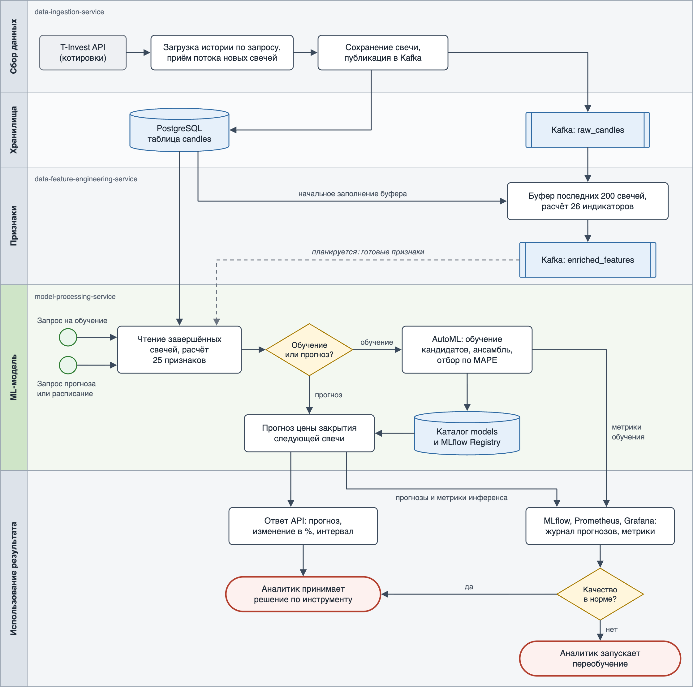

# Место модели в процессе проекта

Проект автоматизирует ML-пайплайн прогнозирования цены акций: от получения котировок до прогноза, которым пользуется аналитик. Модель (AutoGluon TimeSeries, подробности — в [model_card.md](model_card.md)) работает в сервисе `model-processing-service` и стоит между подготовкой данных и принятием решения человеком.

## Схема процесса

Горизонтальные дорожки — этапы процесса и отвечающие за них сервисы; дорожка модели выделена зелёным. Кружки — события запуска, ромбы — развилки, синие блоки — хранилища и топики Kafka, красные — завершающие события. Пунктиром показана связь, которая запланирована, но ещё не реализована.

Редактируемый исходник схемы — [model_bpmn.svg](model_bpmn.svg).

**Текущее состояние.** Топик `enriched_features` пока никто не читает: модель берёт свечи напрямую из PostgreSQL и рассчитывает признаки сама. После подключения потребителя модель будет получать готовые признаки из Kafka, и расчёт признаков полностью перейдёт к сервису признаков.

## Какую задачу в процессе решает модель

Модель отвечает на вопрос «какой будет цена закрытия следующей свечи по инструменту» и даёт три величины: точечный прогноз, ожидаемое изменение к последней цене в процентах и интервал прогноза (квантили 0.1 и 0.9).

В процессе она заменяет ручной анализ графика и индикаторов, который аналитик иначе выполнял бы по каждому инструменту и таймфрейму самостоятельно. Для каждой пары «инструмент + таймфрейм» обучается отдельная модель.

## Почему для этой задачи целесообразно использовать ML

- **Много взаимосвязанных сигналов.** Прогноз опирается на десятки индикаторов (скользящие средние, MACD, RSI, полосы Боллинджера, объём, лаговые доходности). Жёсткие правила вида «RSI выше 70 — продавать» не учитывают их совместное влияние, а модель подбирает зависимости по данным.
- **Рынок меняется.** Паттерны устаревают, и правила пришлось бы пересматривать вручную. Модель переобучается на свежей истории одной командой.
- **AutoML вместо ручного подбора.** AutoGluon сам обучает статистические, табличные и нейросетевые модели, сравнивает их по MAPE на валидации и собирает ансамбль. Добавление нового инструмента или таймфрейма не требует работы ML-инженера.
- **Оценка неопределённости.** Модель выдаёт не только число, но и интервал прогноза.

## Какие данные поступают на вход модели

| Что | Откуда | Описание |
|---|---|---|
| Свечи OHLCV | PostgreSQL, таблица `candles` | Время, цены открытия, максимума, минимума, закрытия и объём; только завершённые свечи. В таблицу их пишет `data-ingestion-service` из T-Invest API: история по запросу и новые свечи потоком |
| Параметры запроса | REST API сервиса | Идентификатор инструмента, таймфрейм (от `1MIN` до `1MONTH`), для прогноза — глубина истории |
| Признаки | Рассчитываются из свечей | 25 технических индикаторов: геометрия свечи, скользящие средние, MACD, RSI, полосы Боллинджера, объём, доходности за 1, 2, 3 и 5 шагов |
| Обученная модель | Каталог `models`, MLflow Registry | Нужна только для прогноза |

Для обучения берётся вся история инструмента на выбранном таймфрейме (не меньше 100 свечей), для прогноза — последние 60 свечей по запросу или 100 в задаче по расписанию (не меньше 30).

## Как результат работы модели используется дальше

- **Ответ API аналитику.** `POST /api/v1/predict` возвращает прогноз цены, изменение в процентах, интервал и дату прогноза. Аналитик использует его как один из сигналов при решении по инструменту; автоматических сделок система не совершает.
- **Прогнозы по расписанию.** Задача планировщика (cron) делает прогноз без участия человека и записывает его в MLflow — получается история прогнозов по инструменту.
- **Мониторинг.** Прогнозы и результаты обучения уходят в Prometheus и отображаются в Grafana: MAPE лучшей модели и всех кандидатов, предсказанная цена, распределение предсказанных изменений, время и ошибки инференса.
- **Обратная связь.** Если на дашборде видно ухудшение качества или прогнозы выглядят аномально, аналитик запускает переобучение (`POST /api/v1/`), и цикл повторяется на свежих данных. Автоматического переобучения пока нет.
- **Реестр моделей.** Каждая обученная модель регистрируется в MLflow Registry с метриками и параметрами, а запуск фиксируется в таблице `model_training_runs` — это позволяет сравнивать версии и разбирать, какой моделью сделан прогноз.
