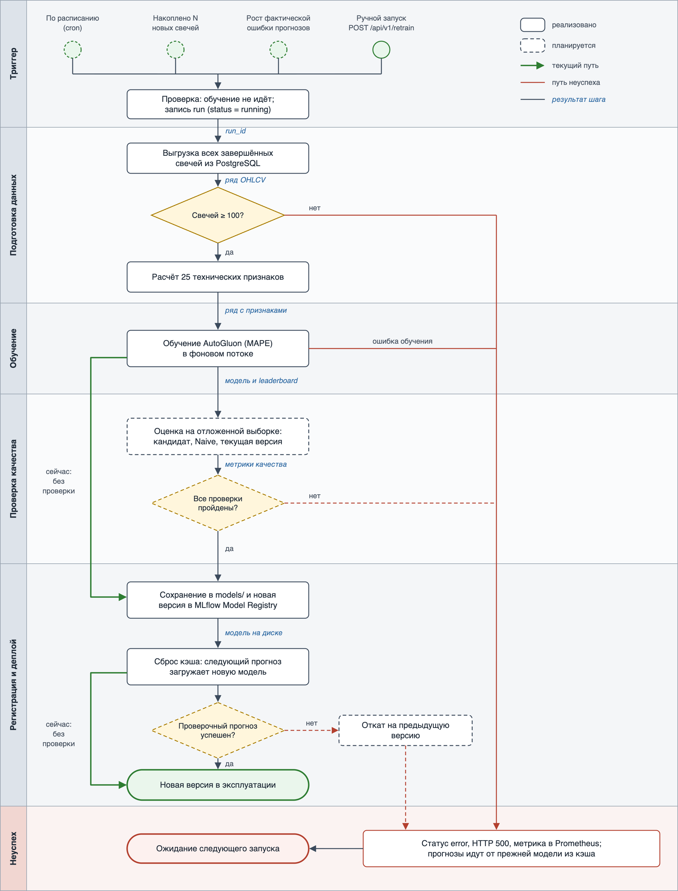

# Процесс переобучения модели

Документ описывает переобучение модели прогноза цены закрытия — от триггера до ввода новой версии в эксплуатацию. Подробности о модели — в [model_card.md](model_card.md), её место в общем процессе — в [Model_BPMN.md](Model_BPMN.md).

**Текущее состояние.** Переобучение запускается вручную запросом `POST /api/v1/retrain`. Сервис обучает новую модель и сразу ставит её в эксплуатацию: проверки качества перед публикацией и отката пока нет. Автоматических триггеров тоже нет — планировщик сервиса сейчас запускает только прогнозы, но не обучение.

На схеме и в описании отмечено, какие этапы уже работают, а какие нужно добавить, чтобы переобучение стало автоматическим и безопасным.

## Схема процесса

Горизонтальные дорожки — этапы процесса. Сплошной контур — этап реализован, пунктирный — планируется. Зелёная линия — путь, по которому модель проходит сейчас: после обучения она сразу сохраняется и попадает в эксплуатацию. Красные линии — путь неуспеха; синие курсивные подписи — результат, который этап передаёт дальше.

Редактируемый исходник схемы — [model_retrain_bpmn.svg](model_retrain_bpmn.svg).

## Этапы процесса

### 1. Триггер запуска

| Триггер | Условие | Статус |
|---|---|---|
| Ручной запуск | Аналитик вызывает `POST /api/v1/retrain` с параметрами `instrument_uid`, `interval` и, при необходимости, `time_limit` | реализовано |
| По расписанию | cron-задача планировщика, например раз в неделю для `1DAY` | планируется |
| Накоплены новые данные | С последней свечи, на которой обучалась рабочая модель, пришло не меньше N новых свечей | планируется |
| Рост фактической ошибки | MAPE последних прогнозов относительно реальных цен закрытия выше порога | планируется |

Сервис проверяет, что по этой паре «инструмент + таймфрейм» не идёт другое обучение (иначе отвечает кодом 409), и создаёт запись в таблице `model_training_runs` со статусом `running`.

**Результат:** `run_id` запуска, инструмент, таймфрейм, лимит времени обучения.

### 2. Получение и подготовка данных

Сервис выгружает из PostgreSQL все завершённые свечи пары (`is_complete = TRUE`); если их нет совсем, отвечает кодом 404. Для обучения нужно не меньше 100 свечей (`MIN_CANDLES_TRAIN`). Из свечей рассчитываются 25 технических признаков: геометрия свечи, скользящие средние, MACD, RSI, полосы Боллинджера, объём, доходности.

Планируется: проверять свежесть данных (последняя свеча не старше нескольких интервалов таймфрейма) и откладывать последние свечи для проверки качества.

**Результат:** временной ряд цены закрытия с признаками.

### 3. Обучение новой версии

AutoGluon TimeSeries с пресетом `medium_quality` обучает модели-кандидаты в пределах лимита времени (по умолчанию 120 секунд) и собирает из них взвешенный ансамбль; модели отбираются по MAPE на последней точке ряда. Обучение идёт в отдельном потоке, поэтому сервис продолжает отвечать на запросы. Параметры, признаки и leaderboard записываются в запуск MLflow, MAPE лучшей модели — в метрику Prometheus `model_best_mape`.

**Результат:** обученная модель и leaderboard кандидатов.

### 4. Проверка качества — планируется

Сейчас качество новой модели перед публикацией не проверяется: MAPE внутренней валидации AutoGluon только записывается в MLflow и Prometheus. Он считается на одной точке и поэтому ненадёжен (подробнее — в разделах 6 и 8 [model_card.md](model_card.md)).

Планируемая проверка: последние 20–30 свечей не участвуют в обучении. Новая модель, наивный прогноз «цена не изменится» и текущая рабочая модель прогнозируют каждую из этих свечей на шаг вперёд, после чего сравниваются их MAPE и доля верно угаданных направлений движения цены.

**Результат:** метрики новой модели, наивного прогноза и текущей модели на одних и тех же данных.

### 5. Решение о публикации — планируется

Сейчас в эксплуатацию попадает любая модель, обучение которой завершилось без ошибок.

Планируемые условия публикации — модель выпускается, только если выполнены все:

| № | Проверка | Условие |
|---|---|---|
| 1 | Технический прогон | Обучение без ошибок, прогнозы на отложенной выборке без пропусков |
| 2 | Абсолютное качество | MAPE не выше 3 % — порог «нормы» на дашборде Grafana |
| 3 | Лучше наивного прогноза | MAPE ниже, чем у прогноза «цена не изменится» |
| 4 | Не хуже текущей модели | MAPE не больше MAPE текущей модели × 1,05 |
| 5 | Направление движения | Доля верно угаданных направлений не ниже 50 % |

**Результат:** решение «публиковать» или «отклонить» с причинами.

### 6. Регистрация и сохранение новой версии

Модель сохраняется в каталог `models/{instrument_uid}__{interval}/` (предиктор AutoGluon, `meta.json`, `leaderboard.csv`) и регистрируется в MLflow Model Registry как новая версия модели `Price_Predictor_{instrument_uid}_{interval}`. Запуск в `model_training_runs` получает статус `done`, лучшую модель, MAPE и leaderboard.

**Результат:** модель на диске и номер версии в реестре.

### 7. Деплой

Новая модель разворачивается внутри работающего сервиса, без пересборки Docker-образа: CI/CD через GitHub Actions доставляет код, а модели лежат в томе `model_data`. После обучения `POST /api/v1/retrain` удаляет прежнюю модель из кэша в памяти, и следующий прогноз — по API или по расписанию — загружает новую модель с диска. Старый эндпоинт обучения `POST /api/v1/` кэш не сбрасывает: модель, обученная через него, начнёт работать только после перезапуска сервиса.

Планируется: проверочный прогноз сразу после переключения (модель загружается и возвращает правдоподобное число) и автоматический откат на предыдущую версию, если он не прошёл.

**Результат:** новая модель обслуживает прогнозы; её качество видно на дашборде Grafana.

## При каких условиях модель попадает в эксплуатацию

| | Сейчас | После доработки |
|---|---|---|
| Что запускает | Ручной вызов `POST /api/v1/retrain` | Расписание, новые данные, рост фактической ошибки или ручной вызов |
| Какие проверки проходит модель | Свечей не меньше 100; обучение завершилось без ошибок | Плюс свежесть данных, пять условий на отложенной выборке и проверочный прогноз после деплоя |
| Когда модель попадает в эксплуатацию | Сразу после успешного обучения | Только если пройдены все проверки |

## Действия при неуспехе

| Где произошёл сбой | Что происходит сейчас | Что планируется |
|---|---|---|
| Свечей нет | Ответ 404, запуск не создаётся | — |
| Свечей меньше 100 | Запуск получает статус `error` с текстом ошибки, ответ 500 | Отвечать кодом 422, как старый эндпоинт обучения |
| Ошибка во время обучения | Запуск получает статус `error` с текстом ошибки, растёт счётчик `model_training_runs_total{status="error"}`, ответ 500. Кэш не сбрасывается, поэтому прогнозы идут от прежней модели в памяти | Обучать в отдельный каталог, чтобы сбой не затрагивал файлы рабочей модели |
| Данные устарели | Не проверяется | Статус `error`, обучение не начинается |
| Модель не прошла проверки качества | Не проверяется: модель публикуется | Статус `rejected` с причинами, в эксплуатации остаётся текущая модель |
| Проверочный прогноз не прошёл | Не проверяется | Откат на предыдущую версию, статус `rejected` |
| Сервис перезапустился во время обучения | Запуск навсегда остаётся в статусе `running`, и новые обучения этой пары получают ответ 409 | При старте помечать незавершённые запуски статусом `error` |
